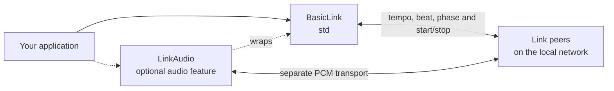

# Ableton Link for Rust

[](https://github.com/anweiss/ableton-link-rs/actions/workflows/ci.yml)

A native Rust implementation of [Ableton Link](https://ableton.github.io/link):
synchronize tempo, beat and phase between applications on a local network.
Supports macOS, Linux and Windows, start/stop synchronization, and optional
LinkAudio PCM streaming. Core timing types also support `no_std` with `alloc`.

## Quick start

Requires Rust **1.87+**. Add the library and Tokio to your application:

<!-- x-release-please-start-version -->
```toml
[dependencies]
ableton-link-rs = "0.4.1"
tokio = { version = "1", features = ["macros", "rt-multi-thread"] }
```
<!-- x-release-please-end -->

```rust
use ableton_link_rs::link::BasicLink;

#[tokio::main]
async fn main() -> Result<(), Box<dyn std::error::Error>> {
    let mut link = BasicLink::new(120.0).await?;
    link.set_num_peers_callback(|count| println!("Peers: {count}"));
    link.enable().await;

    let mut state = link.capture_app_session_state();
    state.set_tempo(140.0, link.clock().micros());
    link.commit_app_session_state(state).await?;

    // Keep Link enabled while your application runs.
    link.disable().await;
    Ok(())
}
```

App-state commits can be rejected; handle the returned error and recapture before
retrying. Audio callbacks use a separate capture/queued-commit API; see the
[API guide](docs/api.md) and [migration contracts](docs/migration.md).

## Features

| Feature | Default | Enables |
|---------|---------|---------|
| `std` | Yes | Networking, peer discovery and the async Link API |
| `audio` | No | LinkAudio PCM channels; implies `std` |

Use `default-features = false` for core types without networking, or
`features = ["audio"]` for LinkAudio.
[Configuration and API examples](docs/api.md) cover both.

## Architecture at a glance



Link Classic synchronizes musical timing; optional LinkAudio adds audio sharing
between audio-enabled peers. Core timing types can also be used without either
network path. See the [component and network diagrams](docs/architecture.md)
for feature boundaries, discovery and audio flow.

## Examples

```bash
cargo run --example rusthut
cargo run --features audio --example link_audio -- my-peer-name main
cargo run --example platform_demo
```

See the [examples guide](docs/examples.md) for controls, playback configuration,
Docker and ESP32 setup. LinkAudio speaker playback uses bounded, nonblocking
buffering with startup/recovery prefill and smoothed discontinuities.

## Documentation

- [Documentation index](docs/README.md): topic map for users, contributors and agents
- [API guide](docs/api.md): session state, audio, encoding, clocks and thread priority
- [Migration and managed-state contracts](docs/migration.md): source changes and concurrency invariants
- [Discovery behavior and evidence](docs/discovery-ingress.md): interface routing and remaining limits
- [Execution and shutdown](docs/execution-lifecycle.md): runtime ownership and callback lifecycle
- [Development](docs/development.md): architecture, build requirements and validation commands
- [Upstream automation](docs/upstream-automation.md): porting, review gates and release setup
- [Changelog](CHANGELOG.md)

The port aims to interoperate with the official C++ Link library. Platform
evidence and unresolved guarantees are documented above; local NIC capture is
not independent peer receipt.

## Contributing and license

Use conventional commits and run the [development checks](docs/development.md#contributing)
before opening a PR. Tests require Rust **1.88+** and run serially.
Keep this README brief; put implementation detail and agent context in `docs/`.

Licensed under [GPL-3.0](LICENSE), consistent with Ableton Link.
[Open an issue](https://github.com/anweiss/ableton-link-rs/issues) for this Rust
implementation; general Link questions can go to <link-devs@ableton.com>.
