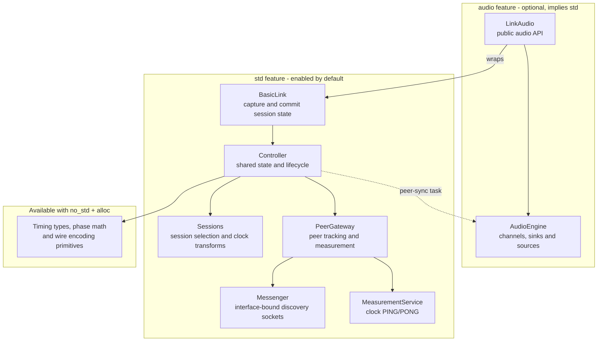
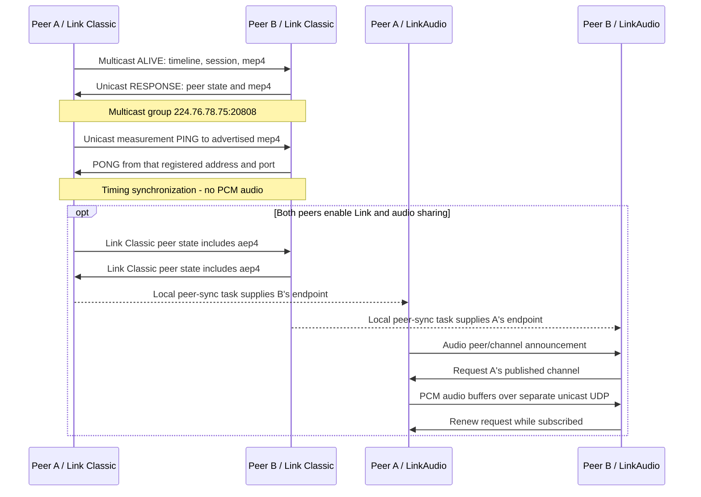

# Architecture

[Documentation index](README.md) | [Project README](../README.md)

These views describe the managed `BasicLink` and `LinkAudio` APIs. They show
component responsibilities and network traffic, not every task, lock or helper.
For the file-by-file layout, see [Development](development.md#architecture).

## Components and feature boundaries

Solid arrows below mean "owns or uses", not packet flow. The dashed arrow is
the periodic transfer of discovered peer identity, session and audio endpoints.

`BasicLink` owns a `Controller`. The controller retains an `IoContext`: a
dedicated OS thread running a current-thread Tokio runtime. Managed discovery,
measurement and dispatch tasks run there. `LinkAudio` constructs its engine and
peer-sync task on that same runtime; the boxes above are components, **not
separate threads**. Standalone networking helpers and standalone `AudioEngine`
instances remain caller-managed. See [execution and shutdown](execution-lifecycle.md).

Application capture/commit and audio-callback capture/queued-commit are distinct
paths through `BasicLink`. Audio callbacks do not directly update network state:
the application must drain queued commits from a non-real-time context and
acknowledge results. These timing-state APIs are part of `std`; they do not
require the optional LinkAudio `audio` feature. See the
[API guide](api.md) and [managed-state contracts](migration.md).

With `default-features = false`, only the core types, math and encoding layer
remain; neither network API nor the owned runtime is present.

### Source map

| Diagram element | Implementation |
| --- | --- |
| Feature boundaries | [`lib.rs`](../src/lib.rs), [`link/mod.rs`](../src/link/mod.rs), [`Cargo.toml`](../Cargo.toml) |
| `BasicLink`, session capture and commit | [`link/mod.rs`](../src/link/mod.rs), [`atomic_session_state.rs`](../src/link/atomic_session_state.rs) |
| Controller, sessions and executor | [`controller.rs`](../src/link/controller.rs), [`sessions.rs`](../src/link/sessions.rs), [`io_context.rs`](../src/platform/io_context.rs) |
| Gateway, discovery and measurement | [`gateway.rs`](../src/discovery/gateway.rs), [`messenger.rs`](../src/discovery/messenger.rs), [`measurement.rs`](../src/link/measurement.rs) |
| Audio wrapper, peer sync and transport | [`api.rs`](../src/link_audio/api.rs), [`engine.rs`](../src/link_audio/engine.rs) |

## Network: discovery, clock sync and audio

The sequence below follows two peers on a local IPv4 network. Discovery traffic
finds peers and advertises their state/endpoints; unicast measurement estimates
the clock transform used to align their timelines. Both peers can initiate
discovery and measurement; only one direction is expanded here.

`mep4` advertises an IPv4 clock-measurement endpoint; `aep4` advertises an IPv4
audio endpoint. Neither is the audio payload itself. The audio exchange shown
publishes from A to B; peers can publish and subscribe in either direction.
Solid sequence arrows are network datagrams; dashed arrows are local handoffs.
Announcements repeat while enabled, so the diagram is not a one-time handshake
or a complete protocol trace.

| Path | Endpoint and responsibility |
| --- | --- |
| Link Classic discovery | Multicast `224.76.78.75:20808` plus unicast responses; shared timeline, session identity, start/stop state and endpoint advertisements |
| Managed clock measurement | Unicast to `mep4`; uses the captured interface-bound discovery registration for both PING and PONG, not a second fixed port |
| LinkAudio | Separate IPv4 UDP socket with an OS-assigned port advertised as `aep4`; channel announcements, requests, PCM buffers and audio-protocol PING/PONG |

Managed discovery retains the receiving OS interface index and checks the
registered response route. Missing or stale measurement-route hints fail closed.
This view does not imply atomic interface-incarnation guarantees or validated
ESP-IDF networking; see [discovery behavior and evidence](discovery-ingress.md).
The managed path shown is IPv4, even though separate IPv6 helpers exist.

### Audio API direction

Names are from the library's perspective: an application writes PCM **into a
`LinkAudioSink` to publish**, and subscribes using a **`LinkAudioSource` to receive**.
The engine encodes committed sink buffers and delivers decoded incoming buffers
to source callbacks. The application supplies audio-device capture/playback;
speaker playback is example code, not a service provided by the library.

Audio sharing runs only while both `BasicLink` is enabled and
`enable_link_audio(true)` has been requested. Disabling Link withdraws the audio
endpoint and stops sharing; re-enabling Link resumes sharing if still requested.
This transports audio against the shared beat grid, not a promise of zero
latency. See the [audio API](api.md) and [playback example](examples.md).

Network sources:
[`discovery/mod.rs`](../src/discovery/mod.rs) defines the multicast endpoint;
[`messenger.rs`](../src/discovery/messenger.rs) implements discovery routing;
[`measurement.rs`](../src/link/measurement.rs) and
[`audio_endpoint.rs`](../src/link/audio_endpoint.rs) define the advertised
endpoint entries;
[`link_audio/api.rs`](../src/link_audio/api.rs) bridges peer state into audio;
[`engine.rs`](../src/link_audio/engine.rs) and
[`messages.rs`](../src/link_audio/messages.rs) implement the separate audio
protocol.
